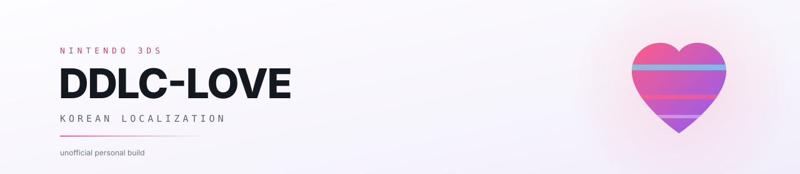

<p align="center">
  <picture>
    <source media="(prefers-color-scheme: dark)" srcset="docs/banner.svg">
    <source media="(prefers-color-scheme: light)" srcset="docs/banner-light.svg">
    
  </picture>
</p>

<p align="center">
  <sub><b>Nintendo 3DS용 DDLC-LOVE에 한국어 번역을 얹는 비공식 빌드</b></sub><br>
  <sub>An unofficial Korean localization build for DDLC-LOVE on Nintendo 3DS.</sub>
</p>

<p align="center">
  <a href="https://github.com/spidychoipro/DDLC-LOVE-KO-3DS/releases/latest"></a>
</p>

<p align="center">
  <a href="https://github.com/spidychoipro/DDLC-LOVE-KO-3DS/actions/workflows/tests.yml"></a>
  
  
  <a href="LICENSE"></a>
</p>

<p align="center">
  <a href="#빠른-시작">빠른 시작</a> ·
  <a href="#설치">설치</a> ·
  <a href="#처음-실행">처음 실행</a> ·
  <a href="#확인한-범위">확인 범위</a> ·
  <a href="#문제-해결">문제 해결</a> ·
  <a href="#자주-묻는-질문">FAQ</a>
</p>

> [!WARNING]
> 비공식 개인 빌드입니다. Team Salvato, LukeZGD, 한국어 패치 제작진과 관계가 없고 공식 배포판도 아닙니다. 이 저장소에는 게임 본체, 번역 데이터, 글꼴, DSP 펌웨어, 세이브 파일이 없습니다. 원본은 각 배포처에서 직접 준비합니다.

## 빠른 시작

<table>
  <tr>
    <td width="33%" align="center" valign="top">
      <b>1 · 내려받기</b><br>
      <sub>최신 릴리스에서<br><code>.cia</code> 또는 <code>.3dsx</code></sub>
    </td>
    <td width="33%" align="center" valign="top">
      <b>2 · 설치</b><br>
      <sub>FBI로 CIA 설치<br>또는 Homebrew Launcher</sub>
    </td>
    <td width="33%" align="center" valign="top">
      <b>3 · 실행</b><br>
      <sub>첫 실행 한글 안내에서<br><kbd>A</kbd> 누르기</sub>
    </td>
  </tr>
</table>

<p align="center"><sub>사운드는 <code>sdmc:/3ds/dspfirm.cdc</code>가 필요합니다. 본인 기기에서 추출한 파일을 넣습니다.</sub></p>

## 무엇을 하는 저장소인가

Nintendo 3DS용 [DDLC-LOVE](https://github.com/LukeZGD/DDLC-LOVE)에 기존 한국어 패치의 번역을 얹는 로컬 빌드 도구입니다. 게임을 새로 만들지 않고, LukeZGD의 Lua 포트와 LovePotion 런타임 위에서 한글 출력과 이름 입력만 손봅니다.

- **결과물** — `.cia`와 `.3dsx`
- **준비물** — 원본 게임과 한국어 패치 (저장소에 포함되지 않음)
- **빌드 위치** — 사용자 PC

### 이런 분께 맞습니다

- 3DS 실기(CFW)에서 한국어로 DDLC를 하고 싶은 분
- PC판 Azahar에서 먼저 확인해 보고 싶은 분
- 직접 빌드해서 결과물을 만들고 싶은 분

번역은 이 저장소에서 만들지 않습니다. 두근두근 문예부 한국어화 패치의 문장을 Lua 대사에 맞추고, 3DS 런타임이 그 문장을 그릴 수 있게 만드는 쪽입니다.

## 설치

권장은 CIA입니다. FBI의 QR 설치로 바로 받거나, SD 카드에 넣어 설치합니다.

### 받아야 하는 파일

| 파일 | 쓰는 곳 | 함께 필요한 것 |
|:--|:--|:--|
| `DDLC-LOVE-KO-0.2.9.cia` | CFW 3DS, PC판 Azahar | Luma3DS, FBI, `dspfirm.cdc` |
| `DDLC-LOVE-KO-0.2.9.3dsx` | Homebrew Launcher, PC판 Azahar | `dspfirm.cdc` |
| `SHA256SUMS.txt` | 내려받은 파일 검증 | — |

릴리스에는 위 파일과 소스 ZIP이 함께 있습니다. 항상 최신 릴리스의 파일을 받습니다. 이전 버전은 실기 확인 결과가 다를 수 있습니다.

### CIA (권장)

<table>
  <tr>
    <td width="250" align="center" valign="top">
      
    </td>
    <td valign="top">
      <p><kbd>FBI</kbd> → <kbd>Remote Install</kbd> → <kbd>Scan QR code</kbd>로 아래 QR을 읽으면 CIA(약 70MB)를 바로 받아 설치합니다.</p>
      <p>SD 카드로 옮기는 경우에는 릴리스에서 CIA를 받아 <kbd>FBI</kbd> → <kbd>SD</kbd> → <kbd>Install and delete CIA</kbd>를 사용합니다.</p>
      <p>QR이 가리키는 주소:<br><a href="https://github.com/spidychoipro/DDLC-LOVE-KO-3DS/releases/download/v0.2.9-beta/DDLC-LOVE-KO-0.2.9.cia">https://github.com/spidychoipro/DDLC-LOVE-KO-3DS/releases/download/v0.2.9-beta/DDLC-LOVE-KO-0.2.9.cia</a></p>
    </td>
  </tr>
</table>

| 항목 | 값 | 항목 | 값 |
|:--|:--|:--|:--|
| Title ID | `0004000000DDFB00` | 제품 코드 | `CTR-P-DLKO` |
| CIA title version | 11 | 크기 | 73,528,256바이트 |

SHA-256은 `ff450bafb4fa8bb0acff3218e0672620ec001dca3501116bc97df1b203d954f7`입니다.

CFW(Luma3DS)가 설치된 기기에서만 설치됩니다. 같은 Title ID를 쓰는 다른 홈브루가 있으면 충돌할 수 있습니다.

> [!TIP]
> 업데이트는 같은 Title ID로 덮어쓰면 됩니다. 저장 식별자와 경로가 그대로입니다. 그래도 설치 전에 저장 폴더를 백업해 두는 편이 안전합니다.

### 3DSX (Homebrew Launcher)

`.3dsx` 파일에는 게임 데이터가 들어 있습니다. SD 카드의 `/3ds/` 아래에 두고 Homebrew Launcher로 실행합니다. PC판 Azahar에서는 파일 열기로 실행하거나 CIA를 설치합니다. 가상 SD에도 `dspfirm.cdc`가 필요합니다.

> [!NOTE]
> 에뮬레이터 확인은 PC판 Azahar에서만 했습니다. 모바일 Azahar, Citra, Lime3DS는 실행해 보지 않았고 동작을 보장하지 않습니다.

## 처음 실행

1. 게임을 실행하면 10016번 안내가 한글로 표시됩니다.
2. <kbd>A</kbd>를 누르면 게임이 시작됩니다.
3. 새 게임을 선택하면 3DS 기본 소프트웨어 키보드가 바로 열립니다.
4. 이름을 입력하면 게임이 시작됩니다.

### 이름 입력

한글, 영문, 둘이 섞인 이름을 UTF-8 그대로 저장하고 마지막 한글 음절을 바이트 단위로 자르지 않습니다. 최대 12글자이고, 취소하면 타이틀 화면으로 돌아갑니다. 따옴표, 역슬래시, 제어 문자는 저장 형식을 깨뜨릴 수 있어서 거부하고 안내를 띄웁니다.

자판에 한글 페이지가 있는지는 기기에 설치된 시스템 키보드와 지역·언어 설정에 따라 다릅니다. 이 빌드는 시스템 자판을 호출할 뿐, 자판 자체를 교체하지 않습니다.

### 저장 데이터

저장 식별자는 `DDLC-3DS-KO`이고 경로는 아래와 같습니다.

```text
sdmc:/3ds/data/LovePotion/DDLC-3DS-KO/
```

같은 식별자를 쓰는 빌드로 업데이트해도 경로가 바뀌지 않습니다. 새 CIA를 설치하기 전에 이 폴더를 백업해 두는 편이 안전합니다.

### 안내가 멈출 때

첫 실행 안내가 멈춘 채로 남으면 아래 로그에서 마지막으로 끝난 준비 단계를 확인합니다.

```text
sdmc:/3ds/data/LovePotion/DDLC-3DS-KO/hardware-startup.log
```

로그에는 이름이나 저장 내용 대신 시작 단계와 글꼴 페이지 번호만 남습니다.

## 원본과 다른 점

원본 DDLC-LOVE는 한글을 전제로 만들지 않았습니다. LovePotion 1.0.9는 글꼴을 바이트 단위로 처리해서 UTF-8 한글 한 글자(3바이트)가 자모로 쪼개지고, 기본 글꼴에는 한글 글리프도 없습니다. 한국어 패치는 Ren'Py용이라 3DS Lua 대사와 바로 연결되지 않고, 시 튜토리얼은 이미지 안에 영어가 박혀 있습니다.

이 빌드는 렌더러, 글꼴, 대사 대응, 이미지 글자 영역을 각각 손봅니다. 원본 타이머와 저장 식별자는 그대로 둡니다.

| 항목 | 원본 DDLC-LOVE | 이 저장소의 빌드 |
|:--|:--|:--|
| 대사 | 영어 | 한국어 패치 문장 |
| 글꼴 | 라틴 문자 중심 | 현대 한글 11,172자 |
| 이름 입력 | 게임 내 자판 | 3DS 기본 소프트웨어 키보드 |
| 시 튜토리얼 | 영어 이미지 | 글자 영역만 한국어 |

## 확인한 범위

현재 빌드는 `0.2.9-beta`입니다. 0.2.7에서 실제 3DS 첫 실행 안내와 게임 진행을 확인했고, 이후 빌드는 그 경로를 유지합니다.

| 구분 | 상태 |
|:--|:--|
| 실기 3DS | 0.2.7 첫 실행 안내·게임 진행 확인, 0.2.9 검은 선 수정 확인 대기 |
| PC판 Azahar | 실행 확인 |
| 모바일 Azahar·Citra·Lime3DS | 미확인 |
| 전체 루트·엔딩, 장시간 메모리 | 미확인 |

<details>
<summary>전체 검사 항목 보기</summary>

### 자동 검사

| 항목 | 결과 |
|:--|:--:|
| Lua 5.1 문법 (47개 파일) | ✅ 통과 |
| 현대 한글 11,172음절 글꼴 생성과 표시 | ✅ 통과 |
| 기본 자판 호출, 한글·영문·혼합 이름, 마지막 음절, 저장 콜백 | ✅ 통과 |
| 취소, 글자 수 제한, 잘못된 문자, 중복 콜백 | ✅ 통과 |
| UTF-8 표시, 304픽셀 줄바꿈, 대사·시 페이지 처리 | ✅ 통과 |
| 대사 9,943개 호출의 일반 영어 잔여 | ✅ 0건 |
| CIA의 NCCH 헤더와 3단계 RomFS 해시 | ✅ 통과 |
| 메뉴 배경 1,920프레임, 미초기화 패딩 | ✅ 통과 |

### 실기와 에뮬레이터

| 환경 | 항목 | 결과 |
|:--|:--|:--:|
| 실기 3DS | 첫 실행 안내와 게임 진행 | ✅ 0.2.7 확인 |
| 실기 3DS | 메뉴 위 검은 선 수정 | ⏳ 확인 대기 |
| 실기 3DS | 전체 루트·엔딩 완주 | ➖ 미확인 |
| 실기 3DS | 장시간 메모리 사용 | ➖ 미확인 |
| PC판 Azahar | 실행 | ✅ 확인 |
| 모바일 Azahar·Citra·Lime3DS | 실행 | ➖ 미확인 |

</details>

확인하지 않은 항목을 완료로 적지 않습니다. 실기 증상이 있으면 기기 종류와 Luma 버전, CIA title version, 로그 마지막 줄을 Issues에 남기면 원인을 좁히기 쉽습니다.

## 동작 방식

<details>
<summary>글꼴·입력·사운드·배경 처리 방식 보기</summary>

### 글꼴

빌드할 때 한국어 패치의 글꼴과 현대 한글 11,172자를 256x256 아틀라스로 굽습니다. 일반 대사용 5페이지(1.25MiB)와 안내 문구용 1페이지(0.25MiB)를 만들고, 이름에 드문 글자가 들어오면 런타임에서 해당 페이지만 추가로 준비합니다.

게임을 그리는 시점에는 GPU 업로드나 쿼드 할당을 하지 않습니다. 텍스처와 쿼드는 초기화·업데이트 단계에서 미리 만들고, draw 콜백은 준비된 자원만 씁니다. 이 제약은 회귀 검사로 고정되어 있습니다.

### 입력 처리

자판을 닫은 직후 남아 있는 키·터치 상태는 무시합니다. 새 X 입력이나 Skip 버튼 안에서 시작한 터치만 스킵으로 인정하고, 새 게임을 시작할 때 자동 넘김과 씬 타이머를 초기화합니다.

### 사운드

이름 입력을 여는 동안에는 타이틀 음악을 멈추고 대기 중인 오디오를 비웁니다. 음악 변경은 첫 씬이 완전히 그려진 뒤로 미루고, 그 다음 업데이트에서 마지막으로 요청된 트랙만 재생합니다.

PC판 Azahar에서는 자판을 닫은 직후 브금이 잠깐 빨라질 수 있습니다. 이 게임의 게임별 Audio stretching을 끄면 정상 속도로 돌아옵니다.

### 배경

메뉴의 움직이는 배경은 512×512 RGBA로 빌드합니다. 구형 LovePotion이 552×528 팔레트 이미지를 1024×1024 텍스처로 확장할 때 남는 미초기화 영역을 없애기 위해서입니다. 화면에 실제로 쓰는 원본 픽셀은 그대로 두고, 쿼드는 업데이트 단계에서 만들어 재사용합니다. 이 수정이 실기에서 검은 선을 없애는지는 아직 확인 중입니다.

</details>

## 직접 빌드

<details>
<summary>고급 · Windows에서 직접 빌드하기</summary>

### 준비물

이 저장소에는 게임 전체, 번역 데이터, 글꼴, Nintendo DSP 펌웨어, 개인 저장 데이터가 들어 있지 않습니다. 아래 파일은 각 배포처에서 직접 받아 준비합니다.

| 준비물 | 받는 곳 |
|:--|:--|
| DDLC-LOVE v1.1.9의 `DDLC-3DS.zip` | [LukeZGD/DDLC-LOVE v1.1.9](https://github.com/LukeZGD/DDLC-LOVE/releases/tag/v1.1.9) |
| 두근두근 문예부 한국어화 패치 1.2 일반 사용자용 ZIP | [배포처](https://sites.google.com/view/dokidokikor) |
| CIA 템플릿 `DDLC-3DS.cia` | 같은 v1.1.9 릴리스 |
| `mkromfs3ds` | [devkitPro](https://devkitpro.org/) |
| `makerom` | [Project_CTR makerom v0.19.0](https://github.com/3DSGuy/Project_CTR/releases/tag/makerom-v0.19.0) |

원본 DDLC는 [공식 사이트](https://ddlc.moe/)에서 받습니다. 한국어 패치 제작진이 원 사이트 링크로 공유하도록 안내하고 있어서, 원본을 직접 준비한 사용자가 로컬에서 변환하는 방식입니다.

### 명령

Python 3.10 이상이 필요합니다. 아래 경로는 예시이니 실제 파일 위치로 바꾸고, 공백이 있는 경로는 따옴표로 묶습니다.

```powershell
python -m venv .venv
.\.venv\Scripts\python.exe -m pip install -r requirements.txt

.\.venv\Scripts\python.exe build.py `
  --assets "inputs/DDLC-3DS.zip" `
  --korean "inputs/korean-normal-1.2.zip" `
  --mkromfs "C:/devkitPro/tools/bin/mkromfs3ds.exe" `
  --cia-template "inputs/DDLC-3DS.cia" `
  --makerom "tools-local/makerom.exe" `
  --fetch-reference
```

`--fetch-reference`는 고정된 커밋의 영문 비교 텍스트를 내려받고 파일별 SHA-256을 검사합니다. 내려받은 Ren'Py 스크립트를 실행하지는 않습니다. 오프라인에서는 같은 파일을 담은 폴더를 `--reference-dir`로 지정합니다.

CIA가 필요 없으면 `--cia-template`과 `--makerom`을 생략합니다. `--lua`에 Lua 5.1 실행 파일을 지정하면 빌드 중 추가 검사를 실행합니다.

### 결과물

`dist/`에 세 파일이 생깁니다.

- `DDLC-LOVE-KO-<버전>.cia` — CFW 3DS와 PC판 Azahar용 설치본
- `DDLC-LOVE-KO-<버전>.3dsx` — Homebrew Launcher와 PC판 Azahar용 실행본
- `SHA256SUMS.txt` — 위 두 파일의 SHA-256

</details>

## 문제 해결

| 증상 | 확인할 것 |
|:--|:--|
| 첫 실행에서 10016 안내가 멈춤 | 새 CIA로 업데이트하고 다시 실행합니다. 세이브는 지우지 않아도 됩니다. New 3DS/XL에서 Luma의 New 3DS CPU를 Clock+L2나 L2로 강제했다면 Off로 두고 확인합니다. |
| 메뉴 위에 검은 선이 보임 | 0.2.9 이상인지 확인합니다. 그래도 남으면 기기 종류, Luma 버전, CIA title version과 함께 이슈에 남깁니다. |
| PC판 Azahar에서 브금이 처음에 빨라짐 | 게임별 Audio stretching을 끕니다. Title ID `0004000000DDFB00`에만 적용합니다. |
| 한글 자판이 보이지 않음 | 기기의 지역·언어 설정과 설치된 시스템 키보드를 확인합니다. 이 빌드가 자판을 추가하지는 않습니다. |
| 설치가 되지 않음 | CFW(Luma3DS), FBI 버전, SD 카드 여유 공간, CIA 다운로드 완료 여부를 확인합니다. 릴리스의 `SHA256SUMS.txt`와 해시를 비교합니다. |
| 소리가 나지 않음 | `sdmc:/3ds/dspfirm.cdc`가 있는지 확인합니다. 본인 기기에서 추출한 파일이어야 합니다. |

## 자주 묻는 질문

### 공식 배포판인가요?

아닙니다. 비공식 개인 빌드 도구이고, 원작·Lua 포트·한국어 패치 제작진과 무관합니다.

### 롬이나 게임 파일을 배포하나요?

아닙니다. 이 저장소에는 도구와 런타임 수정만 있습니다. 게임 자산과 번역은 원 배포처에서 직접 준비합니다.

### 세이브가 사라지나요?

같은 `DDLC-3DS-KO` 식별자를 쓰므로 업데이트로 경로가 바뀌지는 않습니다. 업데이트 전에 백업해 둔 폴더가 있으면 그 폴더로 되돌리면 됩니다.

### 다른 3DS 게임에도 쓸 수 있나요?

아닙니다. DDLC-LOVE의 런타임과 이 게임의 대사 구조에 맞춘 수정입니다.

### 모바일 Azahar나 Citra에서도 되나요?

확인하지 않았습니다. 에뮬레이터는 PC판 Azahar에서만 실행해 봤습니다. 모바일 Azahar와 다른 에뮬레이터는 동작을 보장하지 않습니다.

## 저장소 구조

```text
.
├─ runtime/     한글 렌더러, 기본 자판 이름 입력, 입력 가드
├─ tools/       추출, 번역 대응, 글꼴·이미지 변환, 패키징
├─ tests/       Lua 회귀 검사
├─ docs/        설치 QR, 실기 대응 기록, 사운드 안내
├─ build.py     전체 로컬 빌드 절차
└─ .github/     원본 게임 없이 도는 소스 검사
```

## 크레딧과 라이선스

원작은 Team Salvato의 DDLC이고, 3DS용 Lua 포트는 LukeZGD가 만들었습니다. 런타임은 LovePotion 1.0.9를 씁니다. 한국어 번역과 글꼴은 두근두근 문예부 한국어화 패치 제작진의 것입니다.

이 저장소의 코드에는 GPL-3.0을 적용합니다. 다만 게임 자산, 번역, 글꼴, Nintendo 데이터의 권리까지 GPL로 바뀌는 것은 아닙니다. 포함 관계와 빌드 출처는 [THIRD_PARTY.md](THIRD_PARTY.md)에 정리해 두었습니다.

## 기여

버그나 불편은 [Issues](https://github.com/spidychoipro/DDLC-LOVE-KO-3DS/issues)에 남깁니다. 실기 증상이면 기기 종류, Luma 버전, CIA title version, `hardware-startup.log` 마지막 줄을 같이 적습니다. 코드 변경은 브랜치를 따서 PR로 올립니다.

<div align="center">
  <sub>DDLC-LOVE 한국어판 · 비공식 개인 빌드</sub><br>
  <sub><a href="https://github.com/spidychoipro/DDLC-LOVE-KO-3DS/releases/latest">최신 릴리스</a> · <a href="CHANGELOG.md">변경 이력</a> · <a href="THIRD_PARTY.md">제3자 고지</a></sub>
</div>
