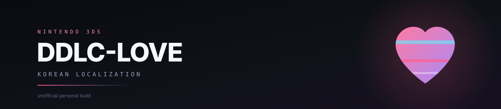

<p align="center">
  
</p>

<p align="center">
  <a href="https://github.com/spidychoipro/DDLC-LOVE-KO-3DS/releases/latest"></a>
  <a href="https://github.com/spidychoipro/DDLC-LOVE-KO-3DS/actions/workflows/tests.yml"></a>
  <a href="LICENSE"></a>
</p>

> [!WARNING]
> 비공식 개인 빌드입니다. Team Salvato, LukeZGD, 한국어 패치 제작진과는 관계가 없으며 공식 배포판도 아닙니다. 이 저장소에는 게임 본체, 번역 데이터, 글꼴, DSP 펌웨어, 세이브 파일이 들어 있지 않습니다. 원본은 각 배포처에서 직접 준비해야 합니다.

## 무엇을 하는 저장소인가

Nintendo 3DS용 [DDLC-LOVE](https://github.com/LukeZGD/DDLC-LOVE)에 기존 한국어 패치의 번역을 얹는 로컬 빌드 도구입니다. 게임을 새로 만들지 않고, LukeZGD의 Lua 포트와 LovePotion 런타임 위에서 한글 출력과 이름 입력만 손봅니다. 빌드는 전부 사용자 PC에서 돌아가며, 결과물은 `.cia`와 `.3dsx`입니다.

번역 자체는 이 저장소에서 만들지 않습니다. 두근두근 문예부 한국어화 패치에 이미 있는 문장을 Lua 대사와 맞추고, 3DS 런타임이 그 문장을 그릴 수 있게 만드는 쪽입니다. 그래서 원본 게임과 한국어 패치를 직접 준비해야 빌드할 수 있습니다.

현재 빌드는 실제 3DS에 설치해 첫 실행 안내와 게임 진행을 확인했습니다. Azahar에서도 같은 빌드가 동작합니다. 전체 루트와 엔딩 완주, 기기별 자판 전환, 장시간 메모리는 아직 확인하지 않았습니다.

## 왜 이 빌드가 필요한가

DDLC-LOVE가 쓰는 LovePotion 1.0.9의 글꼴 처리는 바이트 단위로 동작합니다. UTF-8 한글 한 글자는 3바이트라서 그대로 넣으면 자모가 쪼개지거나 글자 폭이 어긋납니다. 기본 글꼴에도 한글 글리프가 없습니다. 한국어 패치는 Ren'Py용이라 3DS 쪽 Lua 대사와 바로 연결되지 않고, 시 튜토리얼은 이미지 안에 영어가 박혀 있습니다.

이 저장소는 그 세 가지를 각각 처리합니다. UTF-8 경계를 지키는 렌더러와 한글 글꼴을 런타임에 넣고, 패치 문장을 Lua 호출에 대응시키고, 이미지의 글자 영역만 다시 그립니다. 원본 런타임의 타이머와 저장 식별자, 화면 구성은 건드리지 않는 쪽으로 맞췄습니다.

| | 원본 DDLC-LOVE | 이 저장소의 빌드 |
|:--|:--|:--|
| 대사 | 영어 | 한국어 패치 문장 |
| 글꼴 | 라틴 문자 중심 | 현대 한글 11,172자 |
| 이름 입력 | 게임 내 자판 | 3DS 기본 소프트웨어 키보드 |
| 시 튜토리얼 | 영어 이미지 | 글자 영역만 한국어 |

## 빌드 과정

`build.py`는 원본 게임 ZIP과 한국어 패치 ZIP을 입력으로 받아 아래 순서로 결과물을 만듭니다.

1. 두 ZIP을 풀고, 고정된 커밋의 영문 스크립트를 내려받아 SHA-256을 검사합니다. Ren'Py 코드는 실행하지 않고 문자열만 읽습니다.
2. 한국어 패치의 AST에서 대사와 메뉴 문장을 뽑아 Lua 호출과 대응시킵니다.
3. 현대 한글 11,172자와 이름 출력용 글리프를 글꼴 아틀라스로 굽습니다.
4. 시 튜토리얼 이미지의 영어 글자 영역을 한국어로 다시 그립니다.
5. 런타임 패치를 적용하고 `mkromfs3ds`로 RomFS를 묶어 `.3dsx`를 만듭니다. CIA 템플릿과 `makerom`이 있으면 `.cia`까지 만들고, 두 파일의 SHA-256을 기록합니다.

## 지원 환경

- 3DS, 3DS XL, 2DS — CFW(Luma3DS)가 필요합니다.
- New 3DS, New 2DS XL — Luma의 New 3DS CPU 강제 설정은 Off로 두는 편이 안전합니다.
- Azahar — CIA를 설치하거나 `.3dsx`를 직접 실행합니다.
- Citra — 확인하지 않았습니다.
- 홈브루 사운드 — `sdmc:/3ds/dspfirm.cdc`를 본인 기기에서 추출해야 합니다.

## 설치

### CIA (권장)

FBI → Remote Install → Scan QR code로 아래 QR을 읽으면 CIA(73MB)를 바로 받아 설치합니다.


QR이 가리키는 주소: <https://github.com/spidychoipro/DDLC-LOVE-KO-3DS/releases/download/v0.2.7-beta/DDLC-LOVE-KO-0.2.7.cia>

SD 카드로 옮기는 경우에는 릴리스에서 `DDLC-LOVE-KO-<버전>.cia`를 받아 FBI → SD → Install and delete CIA를 사용합니다.

- Title ID: `0004000000DDFB00`
- 제품 코드: `CTR-P-DLKO`
- CIA title version: 9
- 사운드: `sdmc:/3ds/dspfirm.cdc`를 본인 기기에서 추출해 준비

CFW(Luma3DS)가 설치된 기기에서만 설치됩니다. 같은 Title ID를 쓰는 다른 홈브루가 있으면 충돌할 수 있습니다.

### 3DSX와 Azahar

`.3dsx` 파일에는 게임 데이터가 들어 있습니다. 실기에서는 SD 카드의 `/3ds/` 아래에 두고 Homebrew Launcher로 실행합니다. Azahar에서는 파일 열기로 `.3dsx`를 실행하거나 CIA를 설치합니다. 가상 SD에도 `dspfirm.cdc`가 필요합니다.

### 처음 실행

첫 실행에서 10016번 안내가 한글로 표시됩니다. A를 누르면 게임이 시작됩니다. 안내가 멈춘 채로 남으면 SD 카드의 아래 파일에서 마지막으로 끝난 준비 단계를 확인합니다.

```text
sdmc:/3ds/data/LovePotion/DDLC-3DS-KO/hardware-startup.log
```

로그에는 이름이나 저장 내용 대신 시작 단계와 글꼴 페이지 번호만 남습니다.

## 이름 입력

새 게임을 선택하면 Nintendo 3DS 기본 소프트웨어 키보드가 바로 열립니다. 게임이 자판을 직접 그리거나 한글 조합기를 따로 돌리지 않습니다.

한글, 영문, 둘이 섞인 이름을 UTF-8 그대로 저장하고 마지막 한글 음절을 바이트 단위로 자르지 않습니다. 최대 12글자이고, 취소하면 타이틀 화면으로 돌아갑니다. 따옴표, 역슬래시, 제어 문자는 저장 형식을 깨뜨릴 수 있어서 거부하고 안내를 띄웁니다.

자판에 한글 페이지가 있는지는 기기에 설치된 시스템 키보드와 지역·언어 설정에 따라 다릅니다. 이 빌드는 시스템 자판을 호출할 뿐, 다른 지역 자판에 한글 페이지를 추가하거나 자판 자체를 교체하지 않습니다.

## 저장 데이터

저장 식별자는 `DDLC-3DS-KO`입니다. 실제 경로는 아래와 같습니다.

```text
sdmc:/3ds/data/LovePotion/DDLC-3DS-KO/
```

같은 식별자를 쓰는 빌드로 업데이트해도 경로가 바뀌지 않지만, 새 CIA를 설치하기 전에 이 폴더를 백업해 두는 편이 안전합니다. 새 게임을 선택하면 이름 입력 뒤 처음부터 진행합니다.

## 직접 빌드

### 준비물

이 저장소에는 게임 전체, 번역 데이터, 글꼴, Nintendo DSP 펌웨어, 개인 저장 데이터가 들어 있지 않습니다. 아래 파일은 각 배포처에서 직접 받아 준비합니다.

- DDLC-LOVE v1.1.9의 `DDLC-3DS.zip` — <https://github.com/LukeZGD/DDLC-LOVE/releases/tag/v1.1.9>
- 두근두근 문예부 한국어화 패치 1.2 일반 사용자용 ZIP — <https://sites.google.com/view/dokidokikor>
- CIA를 만들 때는 같은 v1.1.9 릴리스의 `DDLC-3DS.cia`
- `mkromfs3ds` — <https://devkitpro.org/>
- `makerom` — <https://github.com/3DSGuy/Project_CTR/releases/tag/makerom-v0.19.0>

원본 DDLC는 [공식 사이트](https://ddlc.moe/)에서 받습니다. 한국어 패치 제작진이 원 사이트 링크로 공유하도록 안내하고 있어서, 원본을 직접 준비한 사용자가 로컬에서 변환하는 방식입니다.

### 명령

Python 3.10 이상이 필요합니다. 아래 경로는 예시이니 실제 파일 위치로 바꾸고, 공백이 있는 경로는 따옴표로 묶습니다.

```powershell
python -m venv .venv
.\.venv\Scripts\python.exe -m pip install -r requirements.txt

.\.venv\Scripts\python.exe build.py `
  --assets "inputs/DDLC-3DS.zip" `
  --korean "inputs/korean-normal-1.2.zip" `
  --mkromfs "C:/devkitPro/tools/bin/mkromfs3ds.exe" `
  --cia-template "inputs/DDLC-3DS.cia" `
  --makerom "tools-local/makerom.exe" `
  --fetch-reference
```

`--fetch-reference`는 고정된 커밋의 영문 비교 텍스트를 내려받고 파일별 SHA-256을 검사합니다. 내려받은 Ren'Py 스크립트를 실행하지는 않습니다. 오프라인에서는 같은 파일을 담은 폴더를 `--reference-dir`로 지정합니다.

CIA가 필요 없으면 `--cia-template`과 `--makerom`을 생략합니다. `--lua`에 Lua 5.1 실행 파일을 지정하면 빌드 중 추가 검사를 실행합니다.

### 결과물

`dist/`에 세 파일이 생깁니다.

- `DDLC-LOVE-KO-<버전>.cia` — CFW 3DS와 Azahar용 설치본
- `DDLC-LOVE-KO-<버전>.3dsx` — Homebrew Launcher와 Azahar용 실행본
- `SHA256SUMS.txt` — 위 두 파일의 SHA-256

## 확인한 범위

빌드와 CI에서 아래 항목을 검사합니다.

- Lua 5.1 문법 (47개 파일)
- 현대 한글 11,172음절 글꼴 생성과 표시
- 기본 자판 호출, 한글·영문·혼합 이름, 마지막 음절, 저장 콜백
- 취소, 글자 수 제한, 잘못된 문자, 중복 콜백
- UTF-8 표시, 304픽셀 줄바꿈, 대사·시 페이지 처리
- 대사 9,943개 호출의 일반 영어 잔여 (0건)
- CIA의 NCCH 헤더와 3단계 RomFS 해시
- 그리기 콜백 안에서 GPU 글꼴 업로드나 쿼드 할당이 없는지

여기에 더해 실제 3DS에서 첫 실행과 게임 진행을 확인했고, Azahar에서도 같은 빌드를 실행했습니다. 전체 루트·엔딩·장시간 메모리는 아직 검증하지 않았습니다.

## 동작 방식

### 글꼴

빌드할 때 한국어 패치의 글꼴과 현대 한글 11,172자를 256x256 아틀라스로 굽습니다. 일반 대사용 5페이지(1.25MiB)와 안내 문구용 1페이지(0.25MiB)를 만들고, 이름에 드문 글자가 들어오면 런타임에서 해당 페이지만 추가로 준비합니다.

게임을 그리는 시점에는 GPU 업로드나 쿼드 할당을 하지 않습니다. 텍스처와 쿼드는 초기화·업데이트 단계에서 미리 만들고, draw 콜백은 준비된 자원만 씁니다. 이 제약은 회귀 검사로 고정되어 있습니다.

### 입력 처리

자판을 닫은 직후 남아 있는 키·터치 상태는 무시합니다. 새 X 입력이나 Skip 버튼 안에서 시작한 터치만 스킵으로 인정하고, 새 게임을 시작할 때 자동 넘김과 씬 타이머를 초기화합니다.

### 사운드

이름 입력을 여는 동안에는 타이틀 음악을 멈추고 대기 중인 오디오를 비웁니다. 음악 변경은 첫 씬이 완전히 그려진 뒤로 미루고, 그 다음 업데이트에서 마지막으로 요청된 트랙만 재생합니다.

Azahar에서는 자판을 닫은 직후 브금이 잠깐 빨라질 수 있습니다. 이 게임의 게임별 Audio stretching을 끄면 정상 속도로 돌아옵니다.

## 문제 해결

- 첫 실행에서 10016 안내가 멈추면 새 CIA로 업데이트하고 다시 실행합니다. 세이브는 지우지 않아도 됩니다. New 3DS/XL에서 Luma의 New 3DS CPU를 Clock+L2나 L2로 강제했다면 Off로 두고 확인합니다.
- Azahar에서 브금이 처음에 빨라지면 게임별 Audio stretching을 끕니다. Title ID `0004000000DDFB00`에만 적용합니다.
- 한글 자판이 보이지 않으면 기기의 지역·언어 설정과 설치된 시스템 키보드를 확인합니다. 이 빌드가 자판을 추가하지는 않습니다.
- 설치가 되지 않으면 CFW(Luma3DS), FBI 버전, SD 카드 여유 공간, CIA 다운로드 완료 여부를 확인합니다. 릴리스의 `SHA256SUMS.txt`와 해시를 비교합니다.
- 소리가 나지 않으면 `sdmc:/3ds/dspfirm.cdc`가 있는지 확인합니다. 본인 기기에서 추출한 파일이어야 합니다.

## 자주 묻는 질문

### 공식 배포판인가요?

아닙니다. 비공식 개인 빌드 도구이고, 원작·Lua 포트·한국어 패치 제작진과 무관합니다.

### 롬이나 게임 파일을 배포하나요?

아닙니다. 이 저장소에는 도구와 런타임 수정만 있습니다. 게임 자산과 번역은 원 배포처에서 직접 준비합니다.

### 세이브가 사라졌어요?

같은 `DDLC-3DS-KO` 식별자를 쓰므로 업데이트로 경로가 바뀌지는 않습니다. 업데이트 전에 백업해 둔 폴더가 있으면 그 폴더로 되돌리면 됩니다.

### 다른 3DS 게임에도 쓸 수 있나요?

아닙니다. DDLC-LOVE의 런타임과 이 게임의 대사 구조에 맞춘 수정입니다.

## 저장소 구조

```text
.
├─ runtime/     한글 렌더러, 기본 자판 이름 입력, 입력 가드
├─ tools/       추출, 번역 대응, 글꼴·이미지 변환, 패키징
├─ tests/       Lua 회귀 검사
├─ docs/        설치 QR, 실기 대응 기록, 사운드 안내
├─ build.py     전체 로컬 빌드 절차
└─ .github/     원본 게임 없이 도는 소스 검사
```

## 크레딧과 라이선스

원작은 Team Salvato의 DDLC이고, 3DS용 Lua 포트는 LukeZGD가 만들었습니다. 런타임은 LovePotion 1.0.9를 씁니다. 한국어 번역과 글꼴은 두근두근 문예부 한국어화 패치 제작진의 것입니다.

이 저장소의 코드에는 GPL-3.0을 적용합니다. 다만 게임 자산, 번역, 글꼴, Nintendo 데이터의 권리까지 GPL로 바뀌는 것은 아닙니다. 포함 관계와 빌드 출처는 [THIRD_PARTY.md](THIRD_PARTY.md)에 정리해 두었습니다.

버그나 불편은 [Issues](https://github.com/spidychoipro/DDLC-LOVE-KO-3DS/issues)에 남겨 주시면 됩니다. 실기 증상이면 기기 종류, Luma 버전, CIA title version, `hardware-startup.log` 마지막 줄을 같이 적으면 원인을 좁히기 쉽습니다. 코드 변경은 브랜치를 따서 PR로 올리면 됩니다.

DDLC-LOVE 한국어판 · 비공식 개인 빌드 · [최신 릴리스](https://github.com/spidychoipro/DDLC-LOVE-KO-3DS/releases/latest) · [변경 이력](CHANGELOG.md)
